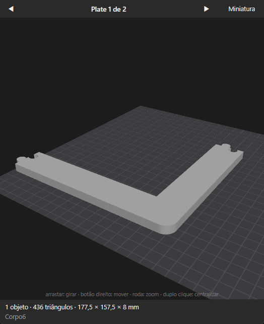
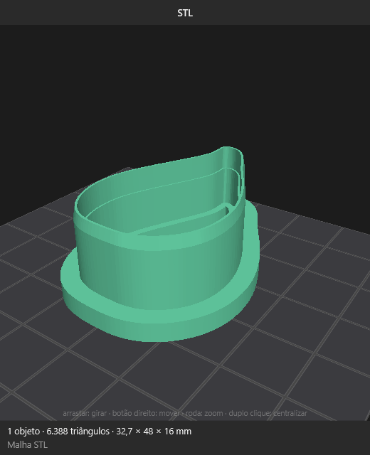
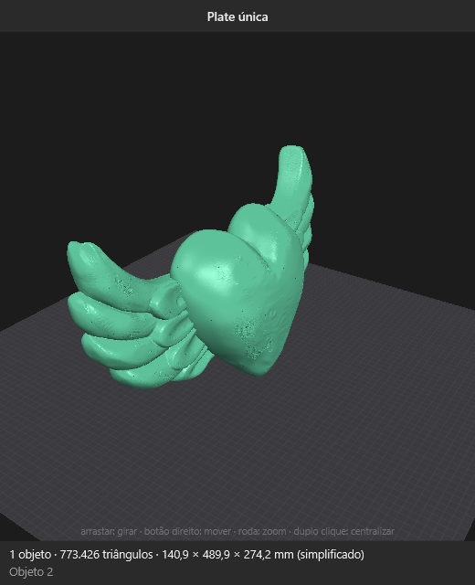

# Prévia 3D no Explorer (3MF · STL · OBJ)

Veja modelos 3D direto no **painel de visualização do Windows Explorer**, sem abrir o fatiador.
Feito para organizar pastas grandes de projetos de impressão 3D, com suporte a **projetos multi-plate do Bambu Studio / OrcaSlicer**.

*[English below](#english)*

| Projeto com várias plates | STL | Modelo pesado (173 MB) |
|---|---|---|
|  |  |  |

## Recursos

- **Navegação entre plates** com ◀ ▶: mostra só os objetos de cada plate, lidos de `Metadata/model_settings.config`.
- **3D interativo**: arrastar gira, botão direito move, a roda dá zoom e duplo clique recentraliza.
- **Cores dos filamentos** do projeto e **mesa da impressora** com grade de 10 mm.
- **Miniatura**: alterna para a imagem da plate salva pelo fatiador, que também aparece na hora enquanto o 3D carrega.
- **Rodapé** com quantidade de objetos, triângulos, dimensões (X × Y × Z mm) e nomes das peças.
- **Arquivos enormes** são simplificados automaticamente por agrupamento de vértices, sem deixar buracos.
- **Tema claro/escuro** seguindo o Windows.
- Também lê 3MF genéricos (componentes, extensão *production*), STL binário/ASCII e OBJ.

## Instalação

Requisitos: Windows 10/11 64-bit (o .NET Framework 4.8 e o compilador C# já vêm no Windows).

```powershell
git clone https://github.com/AndPurger/explorer-3d-preview.git
cd explorer-3d-preview
powershell -ExecutionPolicy Bypass -File .\build.ps1
powershell -ExecutionPolicy Bypass -File .\install.ps1
```

O instalador pede permissão de administrador **uma vez** (UAC) e:

- copia a DLL para `C:\Program Files\Bambu3DPreview`;
- registra a classe COM em `HKLM`, porque o `prevhost.exe`, processo isolado da prévia, só carrega handlers registrados na máquina;
- associa `.3mf`, `.stl` e `.obj` ao handler. O handler anterior do `.3mf`, o leitor da Microsoft, é guardado e restaurado ao desinstalar.

Depois, no Explorer, ative o painel de visualização com **Alt+P** e selecione um arquivo.
Não é preciso iniciar nada junto com o Windows: o próprio Explorer carrega a prévia sempre que você seleciona um arquivo.

Para remover:

```powershell
powershell -ExecutionPolicy Bypass -File .\uninstall.ps1
```

### Visualizador avulso

`Viewer.exe` (instalado junto) abre o mesmo visualizador numa janela. Dá para usar em "Abrir com".

## Limitações

- Partes negativas e modificadores do Bambu Studio são ocultados; o recorte (por exemplo, texto gravado) não é aplicado.
- A pintura multicor por triângulo não aparece: cada peça usa a cor de um filamento só.

## Estrutura

| Arquivo | Função |
|---|---|
| `src/ModelLoader.cs` | Leitura de 3MF (plates, componentes, filamentos, mesa), STL e OBJ |
| `src/PreviewView.cs` | Interface WPF: viewport 3D, câmera orbital, barra de plates |
| `src/PreviewHandler.cs` | Preview handler COM (`IPreviewHandler`, `IInitializeWithStream/File`) |
| `src/Viewer.cs` | Visualizador avulso e gerador de imagens (`--snapshot`) |
| `build.ps1` / `install.ps1` / `uninstall.ps1` / `register-machine.ps1` | Compilação e registro |

Projeto da comunidade, sem afiliação com a Bambu Lab.

---

## English

A **Windows Explorer preview-pane handler** for 3D printing files (`.3mf`, `.stl`, `.obj`), with **per-plate navigation for Bambu Studio / OrcaSlicer projects**.

- ◀ ▶ arrows to browse plates, interactive 3D (orbit, pan, zoom), filament colors, printer bed grid.
- Toggle to the slicer's embedded plate thumbnail.
- Shows object count, triangle count, overall size, and part names.
- Very large meshes are simplified with vertex clustering.

**Install:** run `build.ps1`, then `install.ps1` (asks for admin once: `prevhost.exe` only loads machine-registered handlers and can't read user AppData). Press **Alt+P** in Explorer. **Uninstall:** `uninstall.ps1`.

Built with the C# compiler and WPF that ship with Windows (.NET Framework 4.8), so there are no external dependencies. Not affiliated with Bambu Lab.

## Licença / License

MIT
